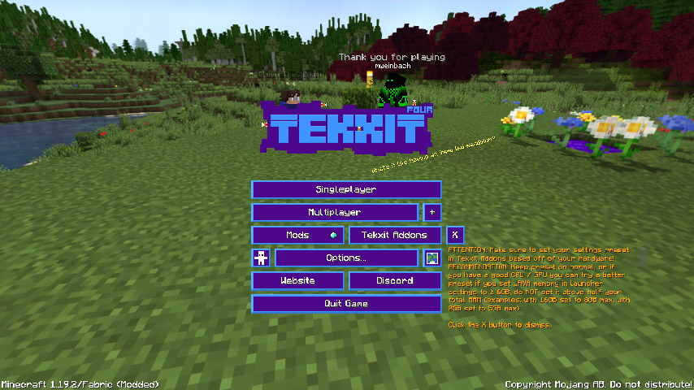
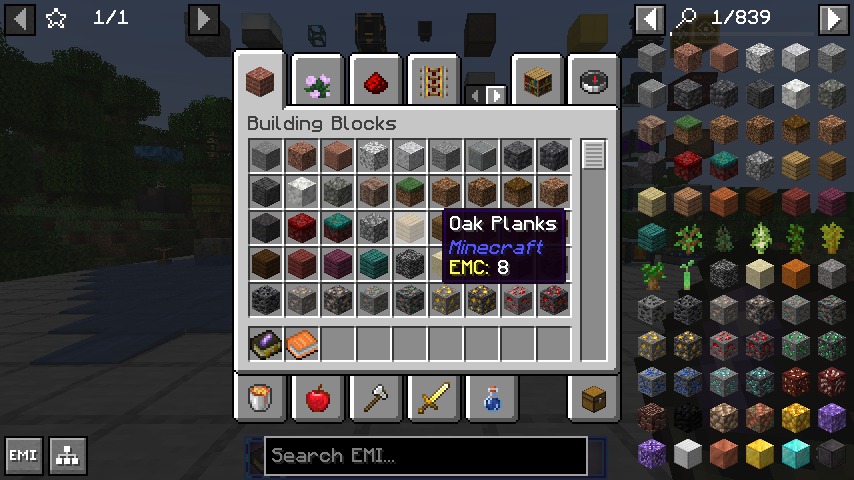
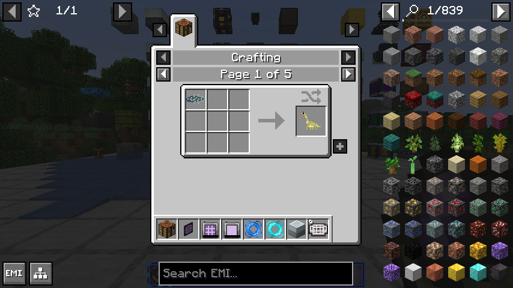
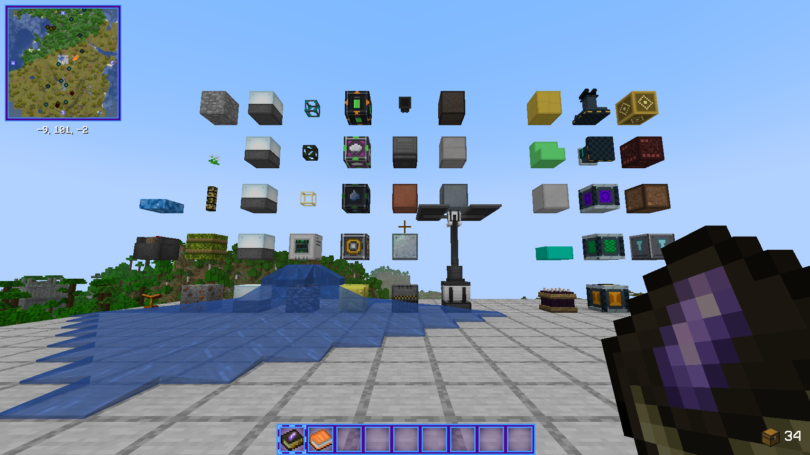
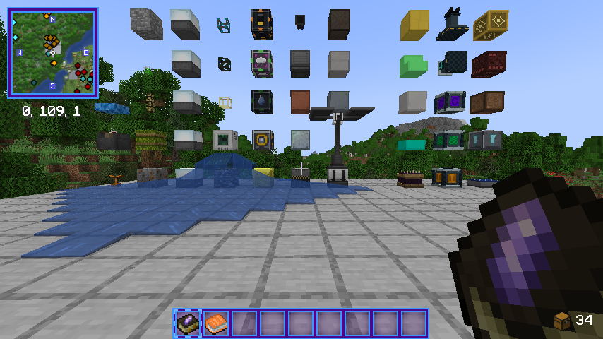
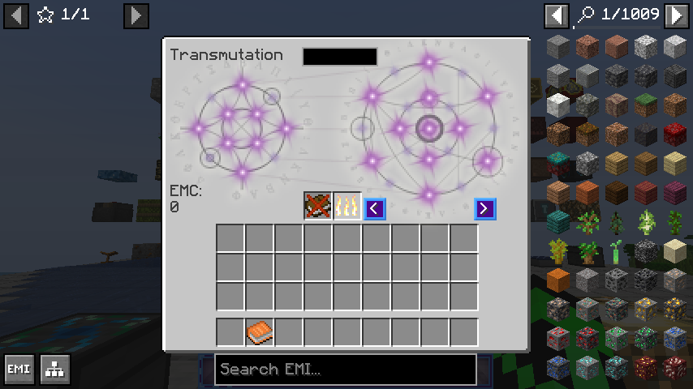
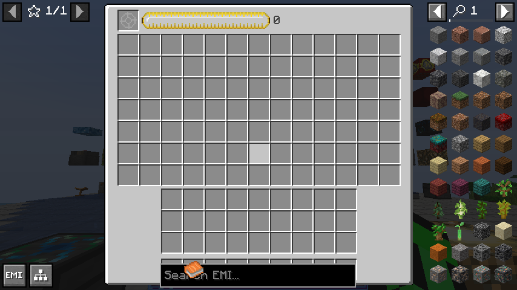
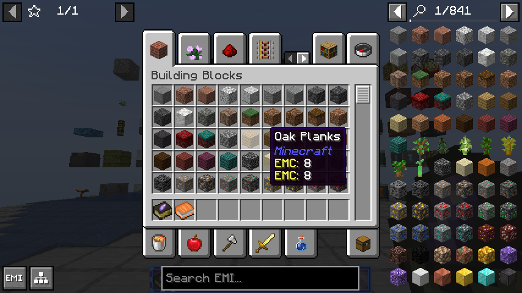
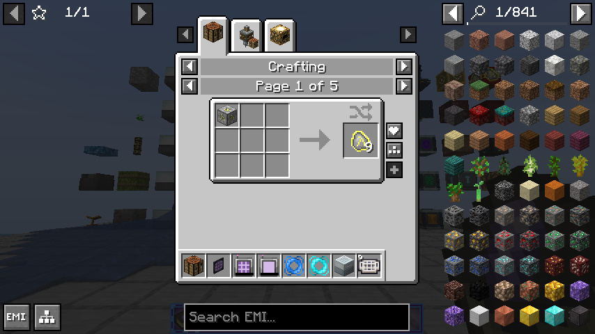

# Tekxit 4 — Mystcraft 0.4 verification

Tested the official Tekxit 4 server 20.0.0 on Minecraft 1.19.2, Java17, Fabric Loader0.18.4 and Fabric API0.77.0+1.19.2, with all440 loaded mods. The disposable server binds localhost25567. Pack mods were retained.

| Installed artifact | SHA-256 |
| --- | --- |
| Mystcraft Fabric0.4.0-dev | `fa372eea04436fc440d3de5728aeedf1d3063ca881de1fff9884686b47129151` |
| Optional server helper | `2f47fc07a13326b08bd4d6c4b27f294f8a321063babf534da6be2977fc69a203` |

The final run passed **25 focused checks** at23:46:04 UTC and **145 full gameplay checks** at23:46:24 UTC on2026-10-18. Evidence: `tekxit4/v04-final-runtime.log` and `v04-final-artifacts.sha256` in the validation archive. A new JVM restored37 Ages and passed both persistence checks at23:48:33 UTC: canonical identity, seed, ordered pages, modified chunks, independent time/weather, and deferred crystal geometry without loading destination chunks. Restart evidence is `tekxit4/v04-final-restart.log`; installed artifact hashes are unchanged.

## Modded treasure fixture correction

The first two candidates exposed a test assumption, not a production loot defect. At seed45022, the loaded table returned eight valid Mystcraft page stacks and an enchanted Simply Swords diamond chakram. The table contained the intact original Mystcraft4–8-roll pool, followed by four Simply Swords pools and one Amethyst Imbuement hammer pool. Counting the whole table as Mystcraft's rolls wrongly rejected that legitimate ninth stack.

The corrected helper validates the exact loaded source-pool schema, executes its native roll/count/weight/luck behavior, and compares that same seeded source output against the whole table by exact stack count and NBT. Additional output must be declared by the appended pools. Across64 seeds the accepted pack run retained all Mystcraft output and produced one declared extra item from those five pools. No production loot, pack configuration or mod was removed to make the check pass. Candidate1/2 logs and artifact hashes remain in the evidence archive.

## Pack adapters and scope

Existing shared adapters and native fixtures continue to cover BCLib generation boundaries, MCA villagers, Origins/Industrial Revolution player initialization, Stxck item merging and Xaero player data. Their earlier investigations are preserved in [the0.3 record](tekxit4-testing-historical-0.3.md); final0.4 acceptance comes from the logs above. The pack retains its preexisting startup warnings and missing-tag reports.

The pack's background threads can keep the JVM alive after vanilla shutdown. Test cleanup issues `stop`, waits for all dimensions to save and Distant Horizons IO to stop, and only then terminates the exact lingering process; that final process status143 is documented separately from passing gameplay checks.

These are dedicated-server tests with native fixture players. They do not establish full-pack graphical-client behavior, simultaneous human clients or a long survival/soak session. Plain Forge and Fabric graphical checks, exact source/runtime scope and installation guidance are recorded in [validation](../mods/mystcraft/docs/validation.md) and [server testing](../mods/mystcraft/docs/server-testing.md). Both loader production JARs remain development builds for disposable-world testing.

## All ports in the Tekxit 4 client and server (2026-10-24)

Every Fabric port from main `ab9b9ef5` plus the fixes in this branch was installed into a copy of the Tekxit 4
20.0.4 client. Each port was also booted in a disposable dedicated server built from the same pack. Fabric Loader 0.18.4,
Fabric API 0.77.0+1.19.2, Java 17.0.15 (Prism's runtime), macOS 27.2 on Apple silicon.

| Input | SHA-256 |
| --- | --- |
| Tekxit 4 20.0.4 client pack (`20.0.4Tekxit4.zip`, 317 mods) | `f76b680a49cc181a331904af94f72fb73d0483434b25f11fa3340ee280de6826` |
| Tekxit 4 20.0.0 server pack (`20.0.0Tekxit4Server.zip`), mods aligned to 20.0.4 | `23434145235ab5b36f1d5597f01241dcfc2f7f65d60ede1e1357e2592c24dcf6` |

| Installed port jar | SHA-256 |
| --- | --- |
| mystcraft-fabric-1.19.2-0.4.0-dev | `8da11570ea3aea1c394da37078fff067d4686b6a20ef4281d94c5df9d33bbdc8` |
| jurassicraft-fabric-1.19.2-0.1.0-alpha.1 | `f1f4108ce4396a6d5ba3ee0d79cc5ff29f3a5c0c115996814ef95ef1853635e9` |
| advancedgenetics-fabric-1.19.2-1.0.3-port.1-dev | `8a57407f485c67220f39d023395c0af0ad0ebad9c4c37fa0674b29651922b2a7` |
| buildcraft-fabric-1.19.2-8.0.1-alpha.1 | `3160ff5e30427c26a65635e7ad974a12d9ce628ebc44f9567d9442d81f8103d8` |
| extremereactors-fabric-1.19.2-0.1.0-alpha.1 (`bigreactors`) | `eb137773cd7efe639da38d29a1a652bde69bc16d4dd030fc8280d6630cbd326b` |
| mekanism-fabric-1.19.2-10.3.9-port.1 | `f5b0b7dd8a8f0b29d915cd330ccf8e9a2c57b0d22248369a21b7f83210d3850d` |
| mekanismgenerators-fabric-1.19.2-10.3.9-port.1 | `5f489d870046b971e2f336b0f4c628a54db8fc8db0f9d5ac97f14c34d31ef9db` |
| mekanismtools-fabric-1.19.2-10.3.9-port.1 | `91b400dd6d1f9898cadc253132ff85da7d70510fbbb3142ce295575961b1540d` |
| mekanismadditions-fabric-1.19.2-10.3.9-port.1 | `81c41aee23d112e0860d4edfaa2a1d80431280a816ccb2617c0f4cc90285ad75` |
| icbm-fabric-port-0.2.0-alpha.4 | `0529cb7c9855179933973e0d7faad6fd26402e2d985b38e50002179eb022ac3f` |
| gridwright-fabric-1.19.2-0.1.0-alpha.1 | `4d56514c3dbb5310ac733aa47244f5b724a279025bc99583a220ffda4b54a5e0` |
| metalrender-fabric-1.19.2-0.2.0 (MetalRender runs only) | `974ace4c264eab3daefd6890a9c601576aac32290f4f47aa8f528497af1a4ca1` |

Fluid Physics 0.1.0 is nested inside the ports and was not installed separately. Item Alchemy 1.1.3 is Tekxit's optional
add-on: `TKXAddons/itemalchemy.jar` is in both pack zips, and the pack ships its `emc_config.json`. It was enabled
in the test copy and the server (`31e3a0c9eb8cfb4fd0b3e8e22cc57e3a97415f2b902145fca3a02edbbc02ea95`). The user's
original instance does not have it.

The pack's own library copies won in every case: Porting Lib 2.1.942, Cardinal Components 5.0.2, cloth-config
8.3.134, Team Reborn Energy 2.3.0, MixinExtras 0.5.0 and EMI 1.1.24. The ports downgraded and replaced nothing. Fabric
Loader resolved 537 mods on the client. The extra mod count comes from nested jars.

### Method

- **Client.** A copy of the user's Prism instance, named `Tekxit 4 + Mystcraft2 ports (test)`, was launched through
  Prism with the existing account. The original instance was not modified. The test-only probe in
  [`tools/tekxit4-probe`](../tools/tekxit4-probe/README.md) drives each boot:
  1. title screen;
  2. new disposable creative world;
  3. in-world showcase of placed port blocks;
  4. every port creative tab;
  5. an EMI recipe page for each port;
  6. the integrated-server checks and GameTests;
  7. save and quit.
- **Server.** A real dedicated server in the disposable `.local/tekxit4/server-ports` (the user accepted the EULA for
  these directories). It has 279 jars, which is the client set without its 55 client-only mods, plus ServerCore. The
  probe runs the GameTests after `Done` and then issues `stop`. Minecraft's GameTest server cannot be used here
  because BCLib's level-generation hook needs registry access that the GameTest server never provides.
- **Probe checks.** For every port namespace it checks registries, recipes, tags and loot tables, plus models,
  textures, names, key conflicts and the MetalRender status on the client. It also checks Item Alchemy EMC after
  `scripts/emc.py merge-itemalchemy` was run on the test copy's `config/itemalchemy/emc_config.json`.
- **Client verdict.** During these runs the client's PASSED verdict covered only the client stages. The 7/7
  client GameTest results below come from the per-test `passed!` lines and the `All required tests passed` summaries
  in each run's log. The integrated-server results come from its report. After review the verdict became stricter.
  It now fails when:
  - the integrated-server report has failures or is missing;
  - any GameTest fails;
  - no tests were found;
  - not every scheduled test reports within five minutes.

  The rules are in `tools/tekxit4-probe/README.md`.

### Boot matrix

| Boot | Result |
| --- | --- |
| Dedicated server, all ports | `Done (12.591s)`. 454 mods, 20,575 recipes, 0 probe failures, 7/7 Tekxit GameTests passed, clean `stop`. All dimensions saved, then Distant Horizons kept the JVM alive (exit 143, as before). |
| Client, all ports, no MetalRender (run 9) | Title screen, world, showcase, creative tabs, EMI, 7/7 GameTests and save/quit all passed. Integrated-server probe: 0 failures. |
| Client, all ports + MetalRender, Sodium present | Fabric Loader refuses to start: `metalrender 0.2.0 {breaks sodium @ [*]}`. This is intended. |
| Client, all ports + MetalRender, Sodium family removed | Passed every stage. `MetalRender active: Metal 4 (shaders_metal4_1) on Apple M5 Ultra`. |

Item Alchemy EMC had 9,103 entries on the dedicated server and 9,109 on the client, which also loads the client-only
mods. In both, `minecraft:wither_skeleton_skull` = 46,422. The probe also compared 2,091 values from the eight
ports' EMC files in `tekxit-probe/emc/` against the loaded config, with 0 mismatches.

### MetalRender with Tekxit's renderer mods

Tekxit 4 ships Sodium 0.4.4 and three mods that need it: Indium 1.0.9, Sodium Extra 0.4.16 and Reese's Sodium
Options 1.6.4. MetalRender declares `breaks: sodium`. To run it, move those four jars out of `mods/` and add the
MetalRender jar. Then:

- MetalRender takes over terrain on Metal 4 and mirrors the 8192×4096 block atlas.
- Screenshots are captured at the full Retina backing size (1708×960 against 854×480 under Sodium).
- Distant Horizons 2.4.5 initialises and generates LODs. It also logged 10 `Failed to get block color` warnings for
  water: `this.parent` was null in the tint getter of the `BlockAndTintGetter` it wraps. DH then stops reporting that
  block/biome pair. The Sodium boot logged none of these, so DH's water tint lookup depends on the Sodium/Indium path
  that has been removed. The game did not crash, and the in-world screenshots are not blank.
- Lambdynamiclights only suggests Sodium and More Culling only recommends it, so both load either way.
- The pack has no Iris.

Put the four jars back to return to the stock renderer. After these runs the test instance was restored to Sodium.

### Problems found and fixed

| Port | Symptom in Tekxit 4 | Fix | Regression check |
| --- | --- | --- | --- |
| Mekanism | Four mixins conflicted with pack mixins on the same targets: `Entity`, `BaseFireBlock`, `ElytraLayer` and `KeyBindsList`. | Converted to `@ModifyExpressionValue` / `@WrapOperation`, which chain. | `tools/tekxit4-probe/mixin_audit.py` (CI) |
| JurassiCraft | `KeyBindConflictMixin` conflicted with another mod's redirect. | `@WrapOperation`. | same |
| Mekanism | Client crashed in item rendering. Sodium overwrites `ItemRenderer.renderQuadList`, and Mekanism's injection depended on that method body. | Cancellable HEAD inject, limited to Mekanism's own models. | `mixin_audit.py` overwrite rule |
| Mekanism | `FabricLifecycle.whileWritable` froze the worldgen registries for every mod, breaking later pack registrations. | Freezes only what it unfroze. | `FabricRegistryStateGameTests` |
| Mekanism | `ExtendedBlockModelJson` threw "Unknown model loader". This broke 114 other-mod models: AE2, CTM, Twilight Forest, Porting Lib `forge:*`, Mantle, Snowy Spirit. | Leaves loaders it does not know to the other mods. `ModelLoaderKey` logs each one once at debug. | `FabricModelJsonGameTests` |
| Mekanism, JurassiCraft, Advanced Genetics | Mixin fields without a mod prefix were merged into Minecraft classes. JurassiCraft's `Entity.KEY` made Tree Chop's `EntityChopSettingsMixin` fail to apply. | Fields renamed with a mod prefix (`jurassicraft$DATA_KEY` etc.). | `scripts/check_mixin_member_names.py` and `scripts/tests/test_check_mixin_member_names.py` |
| Extreme Reactors | `AbstractMethodError` in production. The multiblock provider interfaces left `getBlockState()` to `BlockEntity`, and remapping renamed only Minecraft's method. | The default methods use `this instanceof BlockEntity`. | `scripts/check_unmapped_overrides.py` runs on CI jars. 42 hits on the old jar, 0 now. |
| Extreme Reactors | ModernFix `dynamic_resources` (on in Tekxit) reported "Model builder depends on itself" for replaced block models. | `ReplacingModelProvider` loads the original first and falls back to the missing model. | `ReplacingModelProviderTest` |
| Extreme Reactors | Fluid buckets had no model. The Fabric `assets/forge/models/item/bucket_drip.json` also clashed with Mekanism's file of the same id. | Bucket models come from a Fabric model provider. The clashing file was removed. Parity docs updated. | Loader parity script |
| Extreme Reactors | 12 turbine rotor models had no particle texture. | Added `particle`. | Probe `blockParticleMissing` |
| Extreme Reactors | `reinforced_reactorfluidport_mekanism_passive` had no loot table. | Added. | `everyBlockWithAnItemHasALootTable` |
| ICBM | The Tekxit dust-gunpowder test assumed Mekanism was absent. | Expects neither ICBM gunpowder recipe when Mekanism is loaded, as in `docs/RECIPES.md`. | `TekxitCompatibilityGameTests` |

The affected ports pass their checks:

- Mekanism Fabric: 275/275 GameTests.
- JurassiCraft Fabric: 264/264 GameTests.
- Advanced Genetics Fabric: 42/42 GameTests.
- Extreme Reactors: 30/30 GameTests on Forge, 31/31 on Fabric.
- Loader parity scripts pass for Mekanism (all four mods), JurassiCraft, Advanced Genetics and Extreme Reactors.

### Remaining warnings (not port defects, or cosmetic)

- **EMI "Stack illegally self-mutated during recipe bake".** Thousands of these lines name JurassiCraft discs, meat and
  eggs. Tekxit re-sends recipes twice while joining a world, so EMI restarts its reload. The restart replaces
  `EmiComparisonDefaults` while the previous bake's index thread is still hashing stacks. Only items with a custom
  comparison change hash, and JurassiCraft registers many of them, so its items fill the log. The final reload
  (`Baked recipes after reload`) completes cleanly. In every run EMI then opened a recipe page for the probe's
  JurassiCraft item, and only does so when that item has recipes. Run 9 logged 174 of these lines and run 8 logged
  4,107, depending on timing. Fixing this needs an EMI-side lock. EMI 1.1.24 is pinned by the pack.
- **Item particle textures.** 21 Mekanism item models have no particle texture: the Meka-Tool, personal chest,
  seismic vibrator and the 18 balloons. Their faces render. The upstream assets are the same.
- **Missing names.**
  - 10 Extreme Reactors fluid blocks (the fluids and buckets are named).
  - Entity names for JurassiCraft venom and signs, and Mystcraft link book, meteor, decay and lightning.
  - The base name of `jurassicraft:action_figure` (stacks are named by species).
  - None are visible in normal play.
- **Key conflicts.** Advanced Genetics `G`/`H` collide with Mekanism and Origins. JurassiCraft keys collide with
  other pack keys. Rebind them in Controls.
- **Advanced Genetics upstream orphan models.** `advancedscraper.json` and `dnahelix.json` reference missing
  textures. No item uses them, and they are kept for upstream parity.
- **Balm.** It logs an overwrite notice for `KeyMapping.getKey` against Mekanism's `KeyMappingMixin`. Both return the
  same field.
- **Pack noise.** These also appear in the untouched instance:
  - EMI `VanillaPlugin.addRepair` index errors;
  - Create's potion EMI NPE;
  - "Error reading model … NoSuchElementException";
  - Lambda Better Grass circular model references;
  - Dimensional Doors and Spectrum textures;
  - a malformed resource-pack `pack_format`;
  - Soul Shards' `FireBlock.canBurn` reflection.
- **HotSpot crash.** One client launch was killed by a HotSpot C2 compiler crash (`Chunk::operator delete` in
  `PhaseChaitin::Register_Allocate`, Java 17.0.15) before entering the world. The identical relaunch passed. No mod
  frame was involved.
- **Pause menu.** On that relaunch the game window was in the background, so vanilla kept reopening the pause menu
  until the window was brought to the front. The probe now turns off `pauseOnLostFocus` for the run and restores it
  before quitting.

### Log excerpts

```text
[TEKXIT_PROBE] server checks on class_1132: 0 failure(s), 0 warning(s)
[TEKXIT_PROBE] client result PASSED with 0 failure(s)
[main/ERROR]: Incompatible mods found! ... Mod 'MetalRender' (metalrender) 0.2.0 is incompatible with any version of mod 'Sodium' (sodium)
[Render thread/INFO]: MetalRender active: Metal 4 (shaders_metal4_1) on Apple M5 Ultra
```

### Screenshots

| | |
| --- | --- |
|  |  |
|  |  |
|  |  |

The test instance remains in Prism with the ports, the merged EMC config and Sodium. The probe, the GameTest API and
the ICBM Tekxit test jar were removed after the runs.

## ProjectE Fabric port in Tekxit 4 (2026-10-24)

This repository's ProjectE 1.1.0 Fabric port ([`mods/projecte`](../mods/projecte/README.md)) was added to the same
disposable server copy and Prism test instance as above. Two configurations were tested: (a) beside Tekxit's
Item Alchemy 1.1.3, and (b) with `itemalchemy.jar` removed. The pack inputs, loader, Fabric API and the method are the
same as in the section above. The probe added a ProjectE stage:

- **Server.** It checks ProjectE's anchor values: vanilla items, the Philosopher's Stone and the wither skeleton
  skull loop fix. A wrong anchor is a failure. It also compares each port's expected `projecte` values.
- **Client.** It checks a client-side EMC value, the EMC tooltip and ProjectE's key bindings. It then places the
  Transmutation Table, Alchemical Chest, Energy Condenser MK1, Energy Collector MK1 and Dark Matter Furnace, opens
  each one's screen and takes a screenshot of it.

| Installed jar (this branch) | SHA-256 |
| --- | --- |
| projecte-fabric-1.19.2-1.1.0-port.1 | `0426fe94773a63456e976cbc887594c7d7542cdc7f275520a95d107392df3a1a` |
| advancedgenetics-fabric-1.19.2-1.0.3-port.1-dev (night-config fix below) | `51ce89e41c1b1830e0d9a9370757935043fc25436a74a2a9f3c9b4aabbf181b8` |
| tekxit4-probe-fabric-1.19.2-1.0.0 (test only) | `c90a808f7c443a1e290bb242d2658caa2288c8ba0608402c0b4646d53ff03d60` |
| Item Alchemy 1.1.3 (`TKXAddons/itemalchemy.jar`, configuration a only) | `31e3a0c9eb8cfb4fd0b3e8e22cc57e3a97415f2b902145fca3a02edbbc02ea95` |

The other port jars rebuilt byte-for-byte identical to the table above. Trinkets 3.4.2 and EMI 1.1.24 are the pack's
own copies.

### Boot matrix

| Boot | Result |
| --- | --- |
| Dedicated server (a), with Item Alchemy | `Done (11.583s)`. 456 mods and 20,723 recipes. 0 probe failures, 7/7 Tekxit GameTests, clean `stop`. Distant Horizons then kept the JVM alive, as before. A second boot of the same world: `Done (0.826s)`, the same results, and the JVM exited. |
| Dedicated server (b), without Item Alchemy | `Done (12.204s)`. 455 mods and 20,668 recipes. 0 probe failures, 7/7 Tekxit GameTests, clean `stop` and exit. |
| Client (a), with Item Alchemy | The first launch died in a HotSpot C2 compiler crash while creating the world (see below). The relaunch passed every stage: the title screen, the world, the showcase, every creative tab including ProjectE's, EMI pages including ProjectE's Aeternalis Fuel, the ProjectE stage, the GameTests and save/quit. Only the probe's own GameTest ran (1/1), because the ICBM Tekxit test jar was not installed for this run. Integrated-server probe: 0 failures. |
| Client (b), without Item Alchemy | The first launch died in the same kind of HotSpot crash. The relaunch passed every stage, with 7/7 GameTests (ICBM Tekxit test jar installed). Integrated-server probe: 0 failures. |

The ProjectE stage gave the same result in both clients:

- Diamond EMC on the client is 8,192, and item tooltips show EMC.
- ProjectE's six key bindings are registered.
- These screens opened:
  - `GUITransmutation`;
  - `AlchChestScreen`;
  - `AbstractCondenserScreen$MK1`;
  - `AbstractCollectorScreen$MK1`;
  - `GUIDMFurnace`.

### EMC

| | (a) with Item Alchemy | (b) without |
| --- | --- | --- |
| ProjectE entries after mapping | 6,933 | 6,923 |
| ProjectE anchors: cobblestone 1, iron ingot 256, gold ingot 2,048, diamond 8,192, nether star 139,264, Philosopher's Stone 9,984 | all match | all match |
| ProjectE `minecraft:wither_skeleton_skull` | 46,422 | 46,422 |
| Item Alchemy | 9,132 entries, skull 46,422, 0 mismatches against the 2,091 expected port values | not loaded |

ICBM's `pe_custom_conversions` file sets the skull's value. With it, the Wither loop stays closed under ProjectE in
both configurations, as under Item Alchemy.

The ports' ProjectE values differ from their `emc/values.json` in this pack. Configurations (a) and (b) give the same
differences:

| Port | Differ | Lost value |
| --- | --- | --- |
| BuildCraft | 66 of 230 | none |
| JurassiCraft | 16 of 626 | none |
| Gridwright | 2 of 83 | none |
| Mystcraft | 8 of 24 | none |
| Advanced Genetics | 0 of 94 | none |
| Extreme Reactors | 29 of 113 | `yellorite_ore` |
| Mekanism | 203 of 779 | tin, lead and bronze blocks and nuggets, `nugget_steel` |
| ICBM | 65 of 142 | `iron_plate`, `steel_plate` |

These differences are expected. They are warnings, not failures:

- ProjectE derives values from the recipes a pack actually loads. The values the ports ship are derived from the
  ports' own recipes. In Tekxit, other mods' recipes and Almost Unified's tag unification make many inputs cheaper.
  For example, Tech Reborn's steel makes Extreme Reactors' reinforced parts cheaper.
- The mapper takes the cheapest recipe for each item, so no recipe it maps returns more EMC than it consumes.
- The items that lost their value fall into two groups:
  - Almost Unified replaces these outputs with its preferred mod's items, so no loaded recipe produces them.
  - Tekxit's tags put `yellorite_ore` in an ore tag, and ProjectE's ore blacklist gives ores no EMC. That is upstream
    behaviour.

The CI audits, without the pack, check that the values match exactly (see [emc.md](emc.md)).

### Problems found and fixed

These were found by the live ProjectE audits that every Fabric port's CI GameTests now run, before the pack was
booted. The Tekxit runs found no further ProjectE defects.

| Where | Symptom | Fix | Regression check |
| --- | --- | --- | --- |
| ProjectE (Fabric) | A furnace burning Aeternalis Fuel lost most of its burn time on save. Vanilla saves `BurnTime` as a short; Forge saves an int. | `AbstractFurnaceBurnTimeMixin` stores it as an int when it exceeds `Short.MAX_VALUE`. | `ItemGameTests.longBurnTimeSurvivesSaving` |
| Advanced Genetics (Fabric) | night-config 3.6.6 is nested by ProjectE and Mekanism, and a pack loads the newest copy. Its TOML parser loses table key order, so the config correction reordered keys on every rewrite. | Rebuilds each table in declared order. | AG Fabric GameTests with `-PwithProjectE` |
| Extreme Reactors GameTests | The netherite steel stand-in priced every reinforced part under ProjectE. | The stand-in is off under `-PwithProjectE`. | ER Fabric audit |
| ICBM EMC audit | 81 values were higher than expected without Mekanism. The expected values took Mekanism's cheaper recipes, but ProjectE only sees the recipes that load. | `scripts/emc.py` records `projecte_standalone`, and the audit expects it when Mekanism is absent. | `scripts/tests/test_emc.py`, ICBM audit |

### Remaining warnings

- **Key conflicts.** ProjectE's default keys collide with other pack keys:
  - G with Advanced Genetics, Mekanism and Origins;
  - V with Item Alchemy, Mekanism and voice chat;
  - C with JurassiCraft, Botania and Zoomify;
  - R with JurassiCraft and Observable.

  The helmet and boots toggles are Shift+X and X, as upstream. Rebind the keys in Controls.
- **Item particle textures.** Four ProjectE item models have no particle texture: `alchemical_chest`, `condenser_mk1`,
  `condenser_mk2` and `arcana_ring`. Upstream's generated models are the same, and the items render.
- **HotSpot crashes.** Two client launches were killed by HotSpot C2 compiler crashes in Prism's Java runtime
  (Microsoft OpenJDK 17.0.15). One crashed in `Chunk::operator delete`. The other crashed in `Chunk::next_chop` while
  compiling Distant Horizons' `LodDataBuilder.createFromChunk`. No mod frame was on either stack. Both relaunches
  passed. The earlier all-ports run saw the same crash once.
- **Not covered.** Nobody interacted inside the screens, and nobody played through transmutation in the client. The
  dedicated GameTests cover that gameplay (see [PARITY.md](../mods/projecte/PARITY.md)).

### Screenshots

| | |
| --- | --- |
|  |  |
|  |  |

After the runs, the test instance keeps the ProjectE Fabric jar beside Item Alchemy (configuration a) and the updated
port jars. The probe, the GameTest API, the ICBM Tekxit test jar, the autorun marker and the `Tekxit Probe` world
were removed. The user's `Tekxit 4 (Official)` instance and `accounts.json` were not touched. The disposable server
copies are `.local/tekxit4/server-projecte-a` and `server-projecte-b`.
