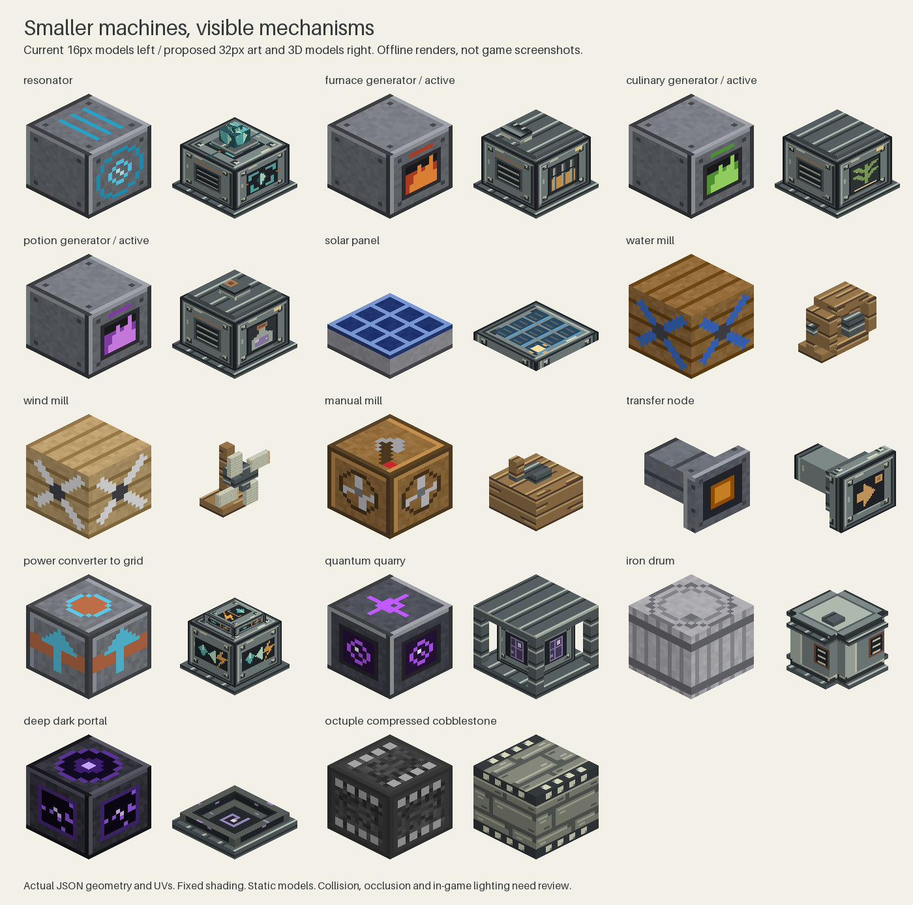
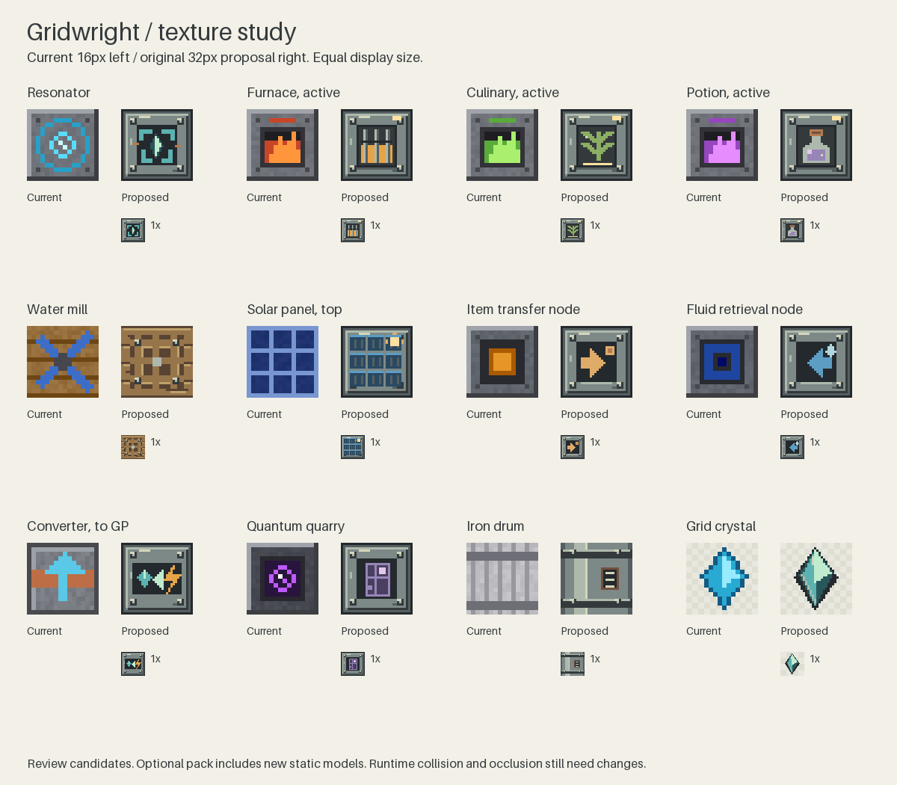
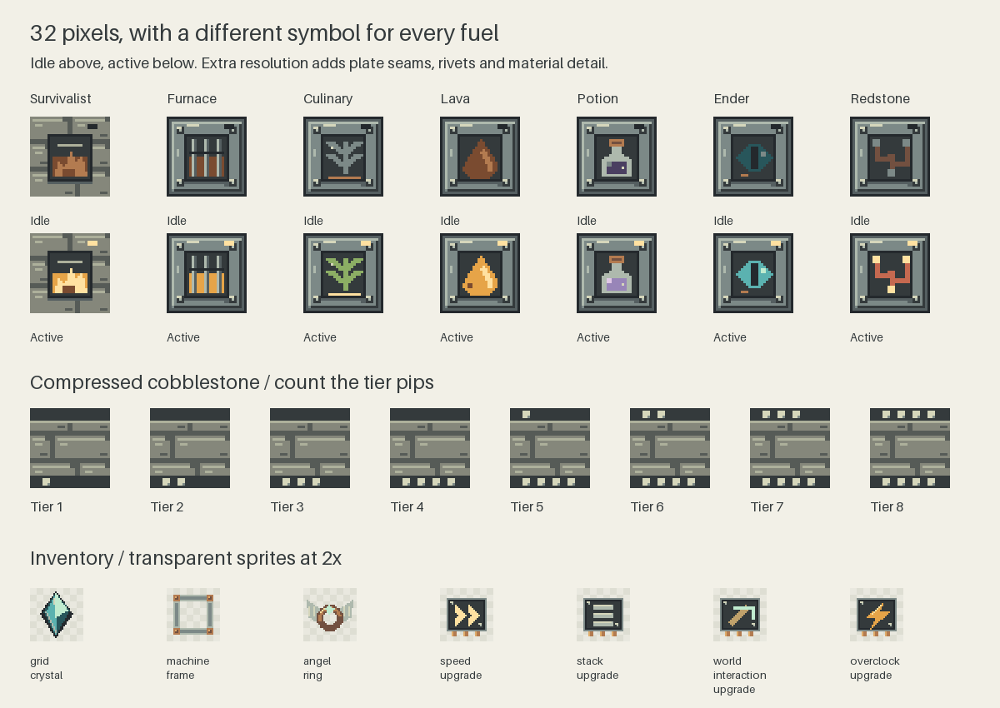

# Gridwright texture and model proposal

Use native 32x32 pixel art and compact, visible machinery. The extra resolution should buy material
detail and readable controls. A water mill should have a wheel with gaps around its spokes. A hand
mill should have a handle. Solar panels should sit close to the floor.

This is a visual proposal for the clean-room rebuild. It includes **73 original texture candidates
and 35 static model candidates** in an optional resource pack. It does not install them in the mod.
The pack covers 69 of the 124 shipped texture paths and adds four small material sheets. The other
55 shipped textures remain as they are. Shared machine casing replacements also affect blocks whose
individual front faces have not been redrawn.

## Look at the proposal

Current assets are on the left, proposed assets on the right. These are offline renders of the actual
JSON cuboids and UVs. They are **not Minecraft screenshots**. The renderer uses fixed face shading and
a depth buffer. It does not reproduce Minecraft's ambient occlusion, lighting, item transforms or
neighbor face removal.







Open [the self-contained review page](texture-study/review.html) locally to search every candidate by
filename. GitHub displays the PNG sheets above; download the HTML to use its search. The exact scope
is in [manifest.json](texture-study/manifest.json).

## What needs fixing

The current art generator draws every texture at 16x16. `casing()` and `noisy()` give most machine
faces the same gray border and random speckle. `generator_front()` draws the same furnace opening
and flame for all seven fuel types. Fuel color is doing most of the work of identification.
`mill_side()` and the phase 2d mills paint a rotor on a cube.

The model audit also matters. Solar and lunar panels already have a six-unit-high model and shape.
Transfer pipes already have a four-unit-wide core and arms. Nodes already have a mounting plate and
stem, with six facing directions. Those are useful starting points. The mills, drums and portal
currently present full block models. Machine screens use rectangles in `MachineScreen` and
`WorkerScreen`, rather than a GUI texture. Replacing world textures will not restyle those screens.

## Art rules

- Draw at 32x32 from the start. The candidate PNGs come from native 32px drawing operations, with
  one-pixel rivet highlights, grain and seams. No 16px source is enlarged to make a candidate.
- Use stone, worn iron, timber and small copper joints. Reserve strong color for a component or
  control. Broad surfaces should have short grain and plate seams instead of random noise.
- Give each fuel a symbol that survives losing its color. Keep the same symbol in the idle and
  active states. The active lens and fuel component brighten only where the existing lit state
  supports it.
- Use cyan crystal marks for GP, amber bolts for FE/TR energy, blue droplets for fluid and a small
  copper crate mark for items. These are functional accents. GP and FE/TR remain separate systems.
- Use alpha 0 or 255 for these candidates. Solid textures and open geometry do not need a translucent
  render layer. Bright pixels are painted highlights, not emissive rendering.
- Keep repeated world textures and inventory edges crisp with nearest-neighbor sampling. Review the
  items at the game's GUI scales, where a 32px source may be displayed smaller.

## Models to build

All dimensions below use Minecraft's 16 model units per block. Texture resolution does not change
that coordinate system or the 0..16 UV range. Every candidate stays within a single block and uses
at most 16 unrotated cuboids. No custom renderer or external model library is needed for the static
proposal.

| Family | Proposed shape | Work required before shipping |
| --- | --- | --- |
| Generators | A 14x12x14 body above a one-unit plinth, inset front, small chimney or bottle collar where useful. Both lit models are included for every fuel. | Match selection and collision shapes, inspect all four facing rotations, keep the existing lit wiring. |
| Resonator | A low 14x10x14 body with a stepped crystal rising from the top. | Match the shape and light occlusion. The crystal is static; it does not claim to show grid status. |
| Solar and lunar panels | A two-unit-thick collector on two short feet, four units tall overall. | Change `ProducerBlock.PANEL` from six units to the proposed shape. Inspect side and underside UVs. |
| Water mill | Timber supports, a central shaft and an open wheel, 14 units tall. | Give `ProducerBlock` a conservative wheel shape and suitable occlusion. Water-flow detection still uses neighboring blocks. |
| Wind mill | Narrow mast and four separated linen sails, one block high. | Match a practical selection/collision shape and lighting. It keeps its current fixed orientation until a separate facing change. |
| Manual mill | An eight-unit-high timber body, raised crank arm and handle. | Update `MillBlock` shapes. Animation needs client state later; this pack keeps the handle static. |
| Fire and lava mills | Low grates with visible bars above the heat chamber. | Update shapes and occlusion. Avoid implying a live fire animation that is not implemented. |
| Dragon egg mill | Narrow pedestal with a full support plate at y=16 for the egg above. | Preserve egg placement/support behavior when changing the shape. Test the top face explicitly. |
| Transfer nodes | Existing plate concept, a stepped collar and a narrower stem. | Update the six rotated `NodeBlock.SHAPES` together. Push/pull symbols identify the node type; arrows are not a world compass. |
| Transfer pipes | Keep the existing 4x4 core and arms, with a new metal texture. | Check all 64 connection masks and UVs. The proposed core/arm dimensions match the current shape. |
| Power converter | A compact body with separate crystal and bolt marks, plus a direction arrow. | Preserve the existing `to_grid` and `to_energy` model selection. Match shape and occlusion. |
| Quarries | Exposed corner frame around a smaller marked core. | Preserve machine-side access and support for the actuator assembly. Quantum and ender quarries have different marks. |
| Iron drum | A stepped octagonal body, separate hoops and a raised bung. | Give `DrumBlock` a matching conservative shape, preserve top stacking/support and bucket interaction. Extend the design to the other tiers later. |
| Deep Dark portal | A four-unit-high stone rim around a recessed pool. | Update `DeepDarkPortalBlock` shape and occlusion. Audit arrival floor detection in `DeepDarkTravel` before reducing the portal height. |
| Compressed blocks | Keep full cubes. Countable tier marks retain material visibility through tier eight. | Carry the system across dirt, gravel, sand and netherrack. No shape change needed. |

The compact blocks need code changes as well as models. `ModBlocks`, `ModPower` and `ModUtilities`
currently register several of them with full-block occlusion assumptions. The implementation PR
must decide `noOcclusion()` and `useShapeForLightOcclusion()` per block, and keep exposed inset faces
visible beside a solid neighbor. The candidates omit `cullface` on inset geometry. This does not
fix the Java-side occlusion assumptions by itself.

## Review in Minecraft

Generate the optional pack and its review files from the repository root:

```sh
python3 -m pip install -r mods/gridwright/scripts/texture-study-requirements.txt
python3 mods/gridwright/scripts/texture_study.py
python3 mods/gridwright/scripts/check_texture_study.py
```

The generator writes a ready-to-install ZIP to
`mods/gridwright/build/texture-study/gridwright-texture-study.zip`. Copy it into a Minecraft 1.19.2
profile's `resourcepacks` folder and enable it above other packs. Alternatively copy the checked-in
[`preview-pack`](texture-study/preview-pack) folder directly. It uses resource pack format 9 and
works with either loader's Gridwright JAR. Disable the pack to restore the shipped assets.

**This pack changes appearance only.** Smaller models retain the current hitboxes, support rules
and occlusion. It is useful for choosing the art direction in a creative test world. It is not the
finished model implementation, and it has not been visually verified in a Minecraft client.
The wind and water rotors, hand crank and portal pool do not animate.

Place candidates on stone, grass, oak and deepslate, then beside a solid block and glass. Look from
above, below, every side and eight blocks away. Check an idle and active generator, both converter
modes, all six node orientations and connected pipe runs. Include a full quantum-quarry assembly,
a dragon egg on its mill, stacked drums and a portal arrival. Inventory checks should include the
creative tab, recipe viewers, first-person hand and a dropped item. Capture the same views on Forge
and Fabric with default lighting before promoting the assets.

## Implementation sequence

1. Review this pack's materials, machine symbols and silhouettes. Rework the sprites or geometry
   here until the direction is settled. The study files are outside production resource roots.
2. Ship the 32px texture pass on existing shapes. Move the agreed drawing functions into the current
   texture generators so regeneration cannot overwrite the new art. Include both generator states,
   shared faces, item sprites and a real client screenshot on each loader.
3. Ship the compact models with their Java shapes and occlusion changes. Start with panels, mills
   and drums. Test interaction faces, water checks, support, stacking and portal arrival before
   changing utility machines. Keep registered IDs, saved data and power behavior stable.
4. Finish the remaining texture families and any agreed rotor animation. Wards, trash cans, spikes,
   tools, the other drum tiers, quarry actuators and non-cobblestone compressed blocks still need a
   complete pass. Restyle machine screens separately around their existing slots and status data.

For each production PR run both loader builds, the loader parity gate, EMC validation and the
Forge/ProjectE and Fabric/Item Alchemy GameTests listed in the mod README. Add shared shape and
interaction tests when the geometry changes. Server tests cannot establish that a model looks right.

## Sources and ownership

The audit used only Gridwright's current code, models, texture generators and public Minecraft
resource conventions. The new pixels and cuboids were authored for this repository. No Extra
Utilities 2 textures, models, source, screenshots or unlicensed rewrites were used. The aim is the
compact utility-machine feel the user requested, with original designs under the repository's MIT
license. See [NOTICE.md](../NOTICE.md).
