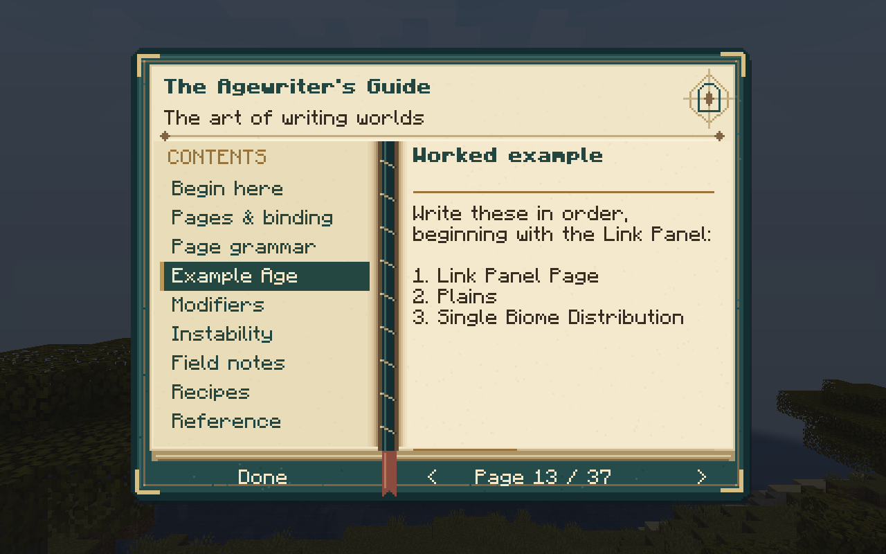
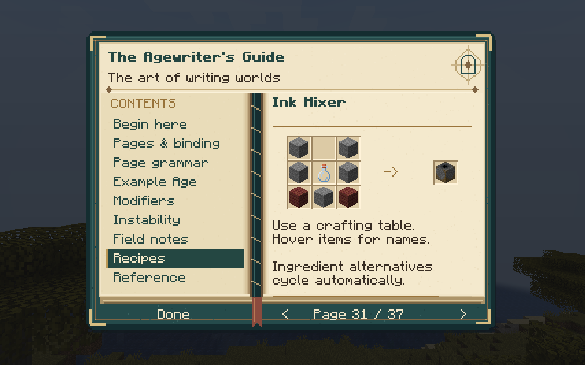

# The Agewriter's Guide

The port adds a read-only guide for players learning to write Ages. Craft it
shapelessly from a vanilla book and feather; acquiring a book unlocks the recipe
in the vanilla recipe book. It is also in the Mystcraft creative tab. Right-click
opens a parchment reader with a stitched teal binding, brass details and a
matching inventory icon. Chapter links make it easy to return to page writing,
worked examples, instability or workstation recipes. The guide uses no external
guidebook dependency, and its English text is in
`assets/mystcraft/lang/en_us.json` for translation.

Use the chapter list to jump between topics. Left/Right or Page Up/Page Down
turn pages; Home/End jump to the first/last page. The reader remembers your page
until the client closes. Longer translations have a scrollbar, Up/Down buttons
and mouse-wheel scrolling. Escape, the inventory key or Done returns to play.

The five workstation recipe pages show crafting grids from the current world's
recipe manager, including cycling tag alternatives and item-name tooltips.
The original text diagrams remain available as a fallback. The guide's own
book-and-feather recipe works in the player's 2×2 inventory crafting grid.

The guide explains workstation recipes, finding and copying owned pages, safe
return links, binding, page ordering, and instability. Its example is an ordered
single-biome Plains Age, with variations and a warning that omitted grammar can
be completed randomly. Configuration and resource profiling can also affect
instability, so the example does not promise a stable Age. The guide describes
this 1.19.2 development port; it is not a claim of complete 1.12 parity.

The grammar and safety guidance was checked against the port's implementation
and the [classic writing guide](http://wiki.mystcraft.xcompwiz.com/v0.13:Writing)
and [instability guide](http://wiki.mystcraft.xcompwiz.com/v0.13:Instability).
The classic reference and attribution are recorded in [NOTICE.md](../NOTICE.md).

## Verification (2026-10-26)

Both loader builds passed all 87 unit tests. The loader parity gate passed with
467 identical gameplay resources and 14 shared GameTests. Repository metadata
and EMC consistency checks also passed. The guide's ordered example is checked
against the real grammar compiler, and its printed recipe patterns are checked
against the shipped recipes.

| Production artifact | SHA-256 |
| --- | --- |
| Fabric | `f456fff52f56611ee8aed7fa51ab9d4694c3a7daab174e0b594cc047f0e9f375` |
| Forge | `e9feb2ca174c2edd3c70971d7e4ac58ac402926ebf61a1f5f2de3a1c92135e49` |

The Fabric + ItemAlchemy and Forge + ProjectE development GameTest runs each
passed all 14 tests, including crafting and using the guide, the example Age
and EMC coverage for all 25 items.

Both development clients exercised opening the held guide, chapter links,
page-turn keys, the remembered page, live ingredient rendering and tooltips.
All 37 pages were captured and checked without clipping in Fabric at a 640×480
window and GUI scale 2 (320×240 logical pixels); Forge's sampled example,
recipe and final pages also fit. The screenshots above were captured in Fabric
at GUI scale 3. These are development-client checks with software rendering,
not production-launcher or full-modpack tests.
